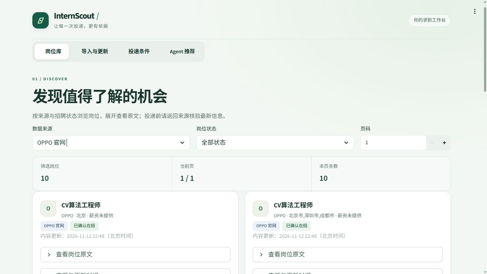

# InternScout Agent

> An AI Agent application for internship discovery, job data processing, explainable candidate-job matching, and semantic job knowledge retrieval.

[](https://github.com/luyangzhan111/internscout-agent/actions/workflows/ci.yml)
[](https://github.com/luyangzhan111/internscout-agent/releases/tag/v1.1.0)


**Current portfolio release: `v1.1.0`**

当前工作区包含 Stage 24 本地试用候选。上手流程无需 DeepSeek 或 embedding 密钥。[候选范围与验收](docs/tasks/stage-24-local-pilot.md)

## Quick Start

在仓库根目录运行 Docker Compose：

```bash
docker compose up --build
```

准备好后打开 <http://127.0.0.1:8501>。首次启动使用空的岗位库，有两种体验方式。

1. **核对真实 JD**。选择 **导入真实岗位**，填写岗位名称、公司、城市和官网来源链接，粘贴职责与要求后保存。到 **投递条件** 填写你已确定的条件并点击判断，展开 **查看五项判断与原文依据**，可用 **前往岗位来源核对** 打开原链接。
2. **先试演示岗位**。选择 **加载演示岗位**，体验岗位浏览和投递条件判断。也可以到 **Agent 推荐**，填写 `Python`，勾选 **包含演示数据（仅用于体验）**，然后点击 **获取推荐**。演示数据有独立标记。

如果使用本机 Python，在 PowerShell 中用 `python --version` 确认版本为 3.12 后，创建环境、安装依赖并启动后端：

```powershell
python -m venv .venv
.\.venv\Scripts\python.exe -m pip install -r requirements.txt
.\.venv\Scripts\python.exe -m uvicorn app.main:app --host 127.0.0.1
```

另开一个终端，在同一仓库根目录启动界面：

```powershell
.\.venv\Scripts\python.exe -m streamlit run demo/app.py --server.address=127.0.0.1
```

更多启动方式、可选模型和排查步骤见[本地部署说明](docs/deployment.md)。

## Stage 14–23

**当前工作区新增 Stage 14：真实岗位导入与更新（尚未发布）。**
启动后选择“岗位库”或“导入与更新”，可无需模型浏览岗位、粘贴真实 JD、限量刷新 OPPO、更新已有岗位并查看运行记录。
旧 SQLite 首次升级会先备份，保留岗位编号与数据。[使用说明](docs/job-imports.md) · [开发任务与验收](docs/tasks/stage-14-real-job-ingestion.md)

**Stage 15：投递条件判断（当前工作区，尚未发布）。**
选择“投递条件”，填写毕业届次、学历、经验、意向城市及实习时长，查看“符合／不符合／待确认”和对应原文。无需模型，候选信息不入库；判断与原有技能分数独立。[使用说明](docs/application-eligibility.md) · [开发任务与验收](docs/tasks/stage-15-application-eligibility.md)

**Stage 16：Agent 推荐接入投递条件（当前工作区，尚未发布）。**
“Agent 推荐”同时展示技能匹配、五项条件和原文依据；符合优先，待确认保留，不符合与关闭单列。模型只补充说明，未配置模型时仍可使用规则推荐。[使用说明](docs/agent-recommendations.md) · [开发任务与验收](docs/tasks/stage-16-agent-eligibility-recommendations.md)

**Stage 17：可信推荐基础版（当前工作区，尚未发布）。**
推荐默认隔离样例及示例链接，跨来源重复岗位只占一个位置并保留来源信息；待确认说明原因分类与下一步建议；技能卡片同时展示匹配项数与已识别项数。[开发任务与验收](docs/tasks/stage-17-trustworthy-recommendations.md)

**Stage 18：目标方向与核心技能推荐（当前工作区，尚未发布）。**
可选择目标岗位方向，明确无关岗位单列；按原文区分核心／加分／未分类技能。同资格组按方向、核心技能和加分技能排序，继续保留总技能覆盖率与原文依据。[开发任务与验收](docs/tasks/stage-18-recommendation-quality.md)

**Stage 19：真实岗位与推荐质量对照（当前工作区，尚未发布）。**
收集五家公司的 30 条官网岗位快照，覆盖 AI 应用、后端、计算机视觉及相邻负例；使用六组合成条件与原文标注，在同一冻结岗位池比较简单技能匹配和当前推荐。评测离线、无需模型，报告前五名相关性、错误推荐、值得核对岗位漏筛与三态一致性；标签为 AI 辅助、项目内复核，尚未经过独立真人验证。[对照结果](docs/evaluations/stage19-analysis.md) · [使用与复跑](docs/recommendation-evaluation.md) · [开发任务与验收](docs/tasks/stage-19-real-data-evaluation.md)

**Stage20：学历/在读与复合方向修复（当前工作区，尚未发布）。**
保留旧数据与旧实现做回归，新增24条官网岗位、8组合成条件、192对盲标，用隔离进程比较技能基线、修复前后规则。新集学历/状态阻断召回21/30→30/30，前五相关25/40→27/40；相关漏筛却从2/49增至5/49，明确保留方向判断副作用，未用新结果调规则。[结果与限制](docs/evaluations/stage20-analysis.md) · [任务与验收](docs/tasks/stage-20-eligibility-compound-directions.md)

**Stage21：方向证据与待确认（当前工作区，尚未发布）。**
逐目标显示匹配依据、明确无关和证据不足；识别出AI职责不再自动排除计算机视觉，待确认继续保留。原54岗转为两批开发回归，另收26条官网岗位、10组条件、260对独立盲标。保留召回收益与待确认噪声的代价，资格、技能分类及排序公式保持。[任务与验收](docs/tasks/stage-21-direction-evidence.md) · [本轮结果及限制](docs/evaluations/stage21-analysis.md)

**Stage22：学历范围与待确认排序（当前工作区，尚未发布）。**
修复研究生/博士生等并列表达，先保存仅学历版本，再按可核对的目标线索排序待确认候选。原80岗作为回归，另收28岗/15公司/280组盲标作四组留出对照：新集前五相关29/50→33/50、明确错误20/50→15/50，有用漏筛4/47→2/47。候选保留集合与技能基线保持，仍有学历分支和城市误判，来源集中、尚无真人验证。[任务与验收](docs/tasks/stage-22-degree-uncertain-ranking.md) · [结果与限制](docs/evaluations/stage22-analysis.md)

**Stage23：复杂学历分支与混合工作地点（当前工作区，尚未发布）。**
区分共同招募学历和分支能力说明，明确学生身份仍核对；混合办公的异地权限不明时保留待确认，明确到岗、远程否定和地域限制仍严格。原108岗/912对标签保留回归，另补33条官网岗位、16主体、330对盲标并全量交叉复核；四组离线比较分开解释学历和地点变化，方向/技能/排序公式保持。[任务与验收](docs/tasks/stage-23-education-work-location.md) · [结果与限制](docs/evaluations/stage23-analysis.md)

## Product Preview

当前工作区 Demo 已统一为浅色求职工作台：四个功能页共用导航、卡片与状态标签，支持窄屏单列布局、页面淡入和轻量悬停反馈，并响应系统“减少动态效果”设置。
以下为当前工作区界面；岗位状态来自导入快照，投递前仍需核对来源。

<p align="center">
  
</p>

The demo connects job browsing, import and updates, application eligibility, and explainable recommendations in one workspace.

InternScout Agent 是一个面向招聘岗位发现与候选人匹配场景构建的 AI Agent 应用。

它不是单纯的 LLM API Demo，也不是只有数据采集功能的招聘爬虫。项目从真实岗位数据 pipeline 出发，将 **岗位采集、数据清洗、数据库、FastAPI、Agent Tool Calling、确定性岗位匹配、Semantic Retrieval、Evaluation、CI、Streamlit Demo 和 Docker Compose** 组合成一套完整、可测试、可复现的 AI 应用工程链路。

项目的核心设计原则之一是：

> **Semantic Retrieval 负责提供非结构化语义证据，Deterministic Matching 负责结构化、稳定、可解释的最终匹配逻辑。两者互补，而不是互相替代。**

---

## Highlights

| Area | Implementation |
| --- | --- |
| **Agent Runtime** | `AgentOrchestrator` + `ToolRegistry`，模型驱动工具选择与顺序执行 |
| **Tool Calling** | 岗位搜索、岗位详情、候选人匹配，以及按需启用的语义检索工具 |
| **Real Job Source** | OPPO Careers 招聘源 Adapter |
| **Candidate Matching** | 确定性技能提取、匹配评分、缺失技能分析、城市过滤、稳定排序 |
| **Semantic Retrieval** | `JobDocument` + `EmbeddingProvider` + `VectorStore` + cosine similarity |
| **Retrieval Runtime** | lazy indexing + dirty tracking + build-then-swap |
| **LLM Provider** | DeepSeek Responses API Adapter |
| **Evaluation** | Deterministic Agent Evaluation + Retrieval Evaluation |
| **Backend** | FastAPI + SQLAlchemy + SQLite |
| **Product Demo** | Streamlit |
| **Deployment** | Docker Compose local deployment |
| **Quality** | GitHub Actions CI + **710 passed** release regression |

---

## What It Does

InternScout Agent 支持从岗位数据进入系统，到 Agent 为候选人查询和分析岗位的完整流程。

### 1. Job Data Pipeline

项目实现岗位数据的：

```text
Collection
    ↓
Parsing
    ↓
Cleaning
    ↓
Normalization
    ↓
Deduplication
    ↓
Persistence
    ↓
Query
```

目前支持两类数据来源：

- `MockJobCrawler`：读取本地 sample HTML，用于稳定、离线、可复现的开发和测试。
- OPPO Careers Adapter：通过 `OppoJobSourceClient` 与 `OppoJobCrawler` 验证真实招聘源采集链路。

经过清洗与标准化后的岗位数据通过 SQLAlchemy 持久化到 SQLite，并由 FastAPI 与 Agent Tool 层进一步消费。

---

### 2. Agent Tool Calling

Agent Layer 位于 `app/agent/`。

核心运行时由以下组件组成：

```text
DeepSeek Provider
       ↑
       |
AgentOrchestrator
       |
       v
 ToolRegistry
       |
       +-----------------------+
       |           |           |
       v           v           v
 search_jobs  get_job_detail  match_jobs
                              
                + optional
                    |
                    v
        retrieve_job_knowledge
```

默认 Agent Tools：

- `search_jobs`
- `get_job_detail`
- `match_jobs`

当 Semantic Retrieval Runtime 可用时，会额外注册：

- `retrieve_job_knowledge`

Agent 每次请求独立运行。

当前 Tool Calling Runtime 保持**顺序执行**，不执行 Multi-Agent 或 parallel tool runtime。

---

## Candidate-Job Matching

岗位匹配采用确定性应用逻辑，而不是让 LLM 直接生成一个不可验证的匹配分数。

核心组件包括：

### `CandidateProfile`

负责候选人技能与意向城市输入的验证和标准化。

### `JobSkillExtractor`

根据岗位中的：

- structured skills
- title
- description

提取确定性的技能证据，并执行技能 alias normalization 与去重。

### `CandidateMatcher`

根据候选人技能与岗位技能证据计算：

- matched skills
- missing skills
- match score
- match reasons

### `JobMatchingService`

负责：

```text
Candidate
    ↓
City Filtering
    ↓
Skill Evidence Extraction
    ↓
Deterministic Matching
    ↓
Stable Ranking
    ↓
Top Results
```

这一设计保证：

- 相同输入得到稳定结果；
- 匹配分数可以测试；
- 推荐原因可以解释；
- 缺失技能可以明确展示；
- LLM 不负责最终匹配评分。

---

## Semantic Job Knowledge Retrieval

为了处理岗位 description 等非结构化信息，项目在确定性匹配之外增加了一条独立的 Semantic Retrieval 路径。

```text
Job Database
     |
     v
 JobDocument
     |
     v
EmbeddingProvider
     |
     v
 VectorStore
     |
     v
JobKnowledgeRetriever
     |
     v
retrieve_job_knowledge
     |
     v
AgentOrchestrator
```

核心抽象包括：

- `JobDocument`
- `EmbeddingProvider`
- `VectorStore`
- `JobKnowledgeRetriever`
- `RetrievalRuntime`

当前默认向量实现为：

```text
InMemoryVectorStore
        +
Cosine Similarity
```

项目同时提供 OpenAI-compatible embedding provider adapter，可配置兼容 endpoint。

### Matching vs Retrieval

这两个能力被刻意保持为两条不同路径：

```text
Structured Job Data
        |
        v
Deterministic Skill Evidence
        |
        v
Candidate Matching
        |
        v
Explainable Match Score
```

与：

```text
Unstructured Job Description
        |
        v
Embedding
        |
        v
Vector Search
        |
        v
Semantic Evidence
```

因此：

**Retrieval adds semantic evidence. It does not replace deterministic candidate-job matching.**

Semantic similarity 不直接决定候选人与岗位的最终匹配分数。

---

## Retrieval Runtime Design

Semantic Retrieval 使用 process-local `RetrievalRuntime` 管理索引生命周期。

它没有在 FastAPI 启动时立即 embedding 全部岗位，而采用 lazy rebuild：

```text
Application Startup
       |
       v
RetrievalRuntime
   unready / dirty
       |
       | first retrieval request
       v
Collect Job Snapshot
       |
       v
Build New Index
       |
       v
Successful?
   /        \
 yes        no
  |          |
  v          v
Swap      Keep Old
Index     Retriever
```

岗位数据发生变化后，只调用：

```text
mark_dirty()
```

而不是在 crawl / ingestion 路径中立即执行 embedding。

刷新采用 **build-then-swap**：

- 新索引成功构建后才替换当前 retriever；
- 同数据版本的 refresh 失败时保留旧 retriever；数据库版本已变化时暂时停用旧语义索引，避免返回已关闭岗位；
- 初始构建失败时，Agent 仍可继续使用默认三个非 Retrieval Tools。

这样可以将核心 Agent 能力与可选 Semantic Retrieval 能力解耦。

---

## System Architecture

```text
                         ┌───────────────────┐
                         │   Streamlit Demo  │
                         └─────────┬─────────┘
                                   │
                                   v
                         ┌───────────────────┐
                         │      FastAPI      │
                         └─────────┬─────────┘
                                   │
                                   v
                        ┌─────────────────────┐
                        │ AgentOrchestrator   │
                        └─────────┬───────────┘
                                  │
                                  v
                           ┌──────────────┐
                           │ ToolRegistry │
                           └──────┬───────┘
                                  │
              ┌───────────────────┼───────────────────┐
              │                   │                   │
              v                   v                   v
       Search / Detail      MatchJobsTool     Retrieval Tool
              │                   │                   │
              │                   v                   v
              │          JobMatchingService   JobKnowledgeRetriever
              │                   │                   │
              │          ┌────────┴────────┐          v
              │          │                 │     VectorStore
              │          v                 v          │
              │   JobSkillExtractor  CandidateMatcher│
              │                                      v
              │                              EmbeddingProvider
              │
              └───────────────────┬───────────────────┘
                                  │
                                  v
                        ┌─────────────────────┐
                        │ Job Query / Storage │
                        └─────────┬───────────┘
                                  │
                                  v
                         SQLAlchemy / SQLite
                                  ▲
                                  │
             ┌────────────────────┴────────────────────┐
             │                                         │
             v                                         v
      MockJobCrawler                            OPPO Careers
                                             Source Adapter
```

---

## End-to-End Data Flow

```text
Local Sample HTML                      OPPO Careers
       |                                    |
       v                                    v
MockJobCrawler                     OppoJobSourceClient
       |                                    |
       |                              OppoJobCrawler
       |                                    |
       +--------------> JobCreate <---------+
                            |
                            v
                 Cleaning + Normalization
                            |
                            v
                      Deduplication
                            |
                            v
                 Repository / SQLAlchemy
                            |
                            v
                         SQLite
                            |
              +-------------+-------------+
              |                           |
              v                           v
        REST Jobs API                Agent Tools
                                          |
                                          v
                                  AgentOrchestrator
                                          |
                                          v
                                   DeepSeek Provider
```

---

## Product Demo

项目提供 Streamlit Product Demo，用于展示实际的：

```text
User
 ↓
Streamlit
 ↓
FastAPI
 ↓
Agent Runtime
 ↓
Tools
 ↓
Matching / Retrieval
 ↓
Job Data
```

Demo 支持用户输入：

- candidate skills
- preferred city

并展示：

- 推荐岗位
- match score
- matched skills
- missing skills
- Agent recommendation / explanation

Demo 不直接访问数据库、Matching Service 或 Agent Runtime，而始终通过 FastAPI 与后端交互。

当前岗位库使用本地 SQLite，可包含手动导入、手动刷新 OPPO 或 Mock 数据。Mock 明确标注为样例；系统没有后台自动刷新，岗位状态以原站为准。

项目目前提供本地运行与 Docker Compose 部署方式，**没有 public production deployment**。

---

## Evaluation & Testing

InternScout Agent 不仅验证“程序能否运行”，还针对 Agent 与 Retrieval 行为建立了 deterministic evaluation。

### Release Regression

`v1.1.0` release regression：

```text
710 passed
```

其中包括：

```text
tests/evaluation    95 passed
tests/agent        139 passed
tests/rag           58 passed
```

---

### Agent Evaluation

Agent Evaluation 使用离线、确定性的 evaluation dataset、runner 和 scorers。

当前覆盖 **9 个 deterministic Agent cases**，包括：

- tool selection
- tool sequence
- tool arguments
- tool results
- execution outcome
- answer facts
- empty results
- invalid arguments
- missing job
- unknown tool

Evaluation 不依赖实时 LLM judge。

---

### Retrieval Evaluation

Semantic Retrieval Evaluation 包括：

- **6 个 direct retrieval cases**
- **2 个 Agent retrieval integration cases**

Direct evaluation 验证：

- Hit@K
- Top-1 ranking

Agent integration evaluation 则通过真实 Agent loop 验证：

```text
Agent
 ↓
retrieve_job_knowledge
 ↓
Retriever
 ↓
Tool Result
 ↓
Agent Response
```

CI 中使用的 semantic fixture 是受控、repository-specific 的 deterministic regression fixture。

它用于验证系统行为稳定性，**不代表真实 embedding model 的通用质量 benchmark**。

---

## CI

GitHub Actions 持续验证：

```text
pytest regression
        +
docker compose config validation
        +
Docker image build validation
```

Blocking CI 保持：

- offline
- deterministic
- secret-free
- network-free

因此 CI 不依赖实时 DeepSeek API 或真实 Embedding API。

---

## Tech Stack

### Backend

- Python 3.12
- FastAPI
- SQLAlchemy 2.x
- SQLite
- Pydantic
- httpx

### Agent / AI

- AgentOrchestrator
- ToolRegistry
- DeepSeek Responses API
- Tool Calling
- EmbeddingProvider abstraction
- VectorStore abstraction
- Cosine Similarity
- Semantic Retrieval

### Quality

- pytest
- Deterministic Agent Evaluation
- Retrieval Evaluation
- GitHub Actions CI

### Product & Deployment

- Streamlit
- Docker
- Docker Compose

---

## REST API

| Method | Endpoint | Description |
| --- | --- | --- |
| `GET` | `/` | Service entry |
| `GET` | `/api/health` | Service and database health |
| `POST` | `/api/crawl` | Run local MockJobCrawler ingestion |
| `GET` | `/api/jobs` | Filter and paginate jobs |
| `GET` | `/api/jobs/{job_id}` | Get job detail |
| `POST` | `/api/imports/manual` | Import a pasted JD and its source link |
| `POST` | `/api/eligibility/evaluate` | Check application criteria and return the source evidence |
| `POST` | `/api/agent/recommend` | Rank jobs with rule-based evidence and optional AI explanations |
| `POST` | `/api/agent/query` | Execute one Agent run |

Semantic Job Knowledge Retrieval 当前作为 Agent Tool 提供，没有额外暴露独立 Retrieval HTTP endpoint。

`POST /api/crawl` 当前只执行 Mock 数据采集。

OPPO real-source ingestion 可通过 `POST /api/imports/oppo` 限量手动触发；手动 JD 导入使用 `POST /api/imports/manual`，历史记录使用 `GET /api/imports`。这几个入口无需模型配置。

---

## Provider Configuration

使用真实 DeepSeek Provider 时需要配置：

```text
DEEPSEEK_API_KEY
DEEPSEEK_MODEL
```

启用 Semantic Retrieval 时还需要：

```text
INTERNSCOUT_EMBEDDING_API_KEY
INTERNSCOUT_EMBEDDING_BASE_URL
```

默认配置：

```text
INTERNSCOUT_EMBEDDING_MODEL=text-embedding-v4
INTERNSCOUT_EMBEDDING_DIMENSIONS=1024
```

Embedding configuration 是可选能力。

如果 Embedding Provider 没有配置或不可用：

- FastAPI 仍然可以启动；
- Agent 仍然提供默认三个 Tools：
  - `search_jobs`
  - `get_job_detail`
  - `match_jobs`

只有 Retrieval Runtime ready 时才加入：

```text
retrieve_job_knowledge
```

---

## Project Structure

```text
internscout-agent/
│
├── app/
│   ├── agent/              # Agent runtime, tools, providers
│   ├── api/
│   │   └── routes/         # FastAPI endpoints
│   ├── database/           # SQLAlchemy, repositories, query adapters
│   ├── matching/           # Candidate-job deterministic matching
│   ├── rag/                # Semantic retrieval and vector abstractions
│   └── ...
│
├── demo/                   # Streamlit product demo
├── evals/                  # Agent / Retrieval evaluation datasets
├── tests/                  # Automated test suites
├── docs/                   # Deployment and project documentation
├── .github/workflows/      # GitHub Actions CI
│
├── Dockerfile.backend
├── Dockerfile.demo
├── docker-compose.yml
├── requirements.txt
└── README.md
```

---

## Key Engineering Decisions

### Why not let the LLM calculate match scores?

LLM-generated scores are difficult to reproduce and test.

InternScout therefore keeps:

```text
Match Score = Deterministic Application Logic
```

while the model focuses on orchestration and natural-language interaction.

---

### Why doesn't Retrieval replace Matching?

Semantic similarity and candidate-job suitability are different problems.

Retrieval answers:

> “Which job descriptions are semantically relevant to this query?”

Matching answers:

> “Based on known candidate skills and structured job evidence, how well does this candidate match this job?”

Keeping them separate improves:

- explainability
- testability
- stability
- architectural clarity

---

### Why abstract EmbeddingProvider and VectorStore?

The retrieval domain should not depend directly on one embedding vendor or one vector database.

Therefore the application depends on:

```text
EmbeddingProvider
VectorStore
```

rather than concrete infrastructure.

Current implementation uses an in-memory vector store, while the abstraction leaves room for replacing infrastructure without rewriting the retrieval domain.

---

### Why lazy build-then-swap?

Embedding every job during application startup or ingestion would tightly couple retrieval availability to the core application path.

The Runtime instead:

```text
mark_dirty()
    ↓
lazy rebuild
    ↓
build new retriever
    ↓
successful?
    ↓
swap
```

A failed refresh therefore does not automatically destroy the previously working retrieval state.

---

## Current Scope & Boundaries

InternScout Agent `v1.1.0` intentionally remains a portfolio-scale AI application.

Current boundaries:

- SQLite is the only application database.
- A backed-up, transactional SQLite lifecycle migration is included; there is no general migration framework.
- `POST /api/crawl` currently triggers Mock ingestion only.
- OPPO integration depends on observed recruitment-site interfaces and may require adapter changes if external schemas change.
- Agent runs are request-scoped and do not provide persistent conversation memory.
- Tool execution is sequential.
- No Multi-Agent runtime.
- No parallel Agent execution.
- `InMemoryVectorStore` is process-local.
- No persistent external vector database.
- Retrieval indexing is lazy.
- Retrieval remains optional when embedding configuration is unavailable.
- Controlled Retrieval Evaluation is not a real embedding-quality benchmark.
- Job library supports manual imports and bounded OPPO refreshes; Mock records remain clearly labelled fixtures.
- No public production deployment.

These boundaries are intentional for the current portfolio release and are not presented as production-scale capabilities.

---

## Release

Latest portfolio release:

### [`v1.1.0`](https://github.com/luyangzhan111/internscout-agent/releases/tag/v1.1.0)

Release verification includes:

```text
Full regression             710 passed
Agent evaluation              9 cases
Direct retrieval              6 cases
Agent retrieval integration   2 cases
GitHub Actions CI             PASS
Docker Compose validation     PASS
```

---

## Project Status

GitHub 上当前发布版本为 `v1.1.0`。Stage 14–24 当前处于本地候选范围，试用进度见 [Stage 24](docs/tasks/stage-24-local-pilot.md)。
